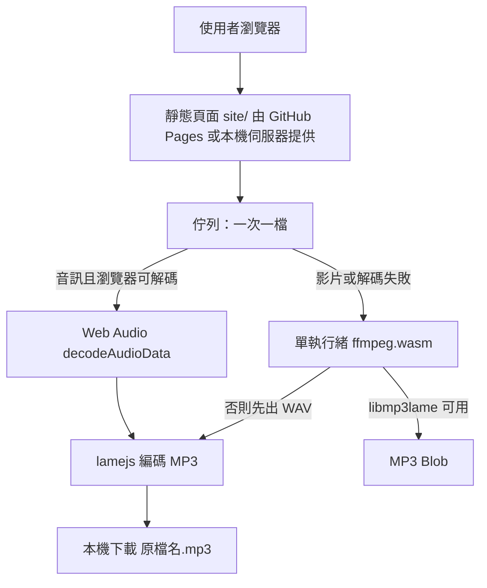

# 04 ARCHITECTURE｜系統架構與技術選擇

- Project ID：CI-2026-002　　版本：v1.0
- 日期：2026-11-21（Asia/Hong_Kong）

## 1. 架構概觀



沒有應用伺服器，也沒有把媒體送到遠端的路徑。

## 2. 技術選擇與理由

| 層級 | 選擇 | 為什麼 | 替代方案 |
|---|---|---|---|
| 前端 | 純 HTML／CSS／ES 模組 | 無需打包即可放上 Pages | React／Vite（对本案過重） |
| 音訊編碼 | lamejs 1.2.1 | 體積小（約 153 KB）、LGPL、不需 SAB | 只用 ffmpeg 編碼 |
| 容器後備 | @ffmpeg/core 0.12.10 **單執行緒** | Pages 不能設 COOP/COEP，core-mt 不穩 | coi-serviceworker（未採用，避免額外失敗點） |
| 載入核心 | 內嵌 + `toBlobURL` | 執行期不依賴 CDN；Worker 同源 | jsDelivr／unpkg |
| 部署 | Actions 只上傳 `site/` | 避免把 docs／測試一併當成網站根目錄（CI-2026-001 的教訓） | 從分支／Jekyll 發佈整倉 |
| 資料 | 無後端 | 隱私要求：檔案不出裝置 | — |

內嵌大小（建置時實際測量）：`site/vendor/` 合計約 **32 MB**，其中 `ffmpeg-core.wasm` 約 **31 MB**（低於 git 單一檔 100 MB 上限）。未內嵌 umd 複本，也未內嵌 lamejs testdata。

## 3. 資料夾結構

```
/
├─ docs/                 # PRD、SPEC、ARCHITECTURE、TEST_REPORT、PROJECT_CARD
├─ site/                 # 可部署的靜態網站
│  ├─ index.html
│  ├─ css/  js/
│  ├─ vendor/            # ffmpeg ESM、單執行緒 core、util、lame.min.js
│  └─ .nojekyll
├─ tests/                # Playwright 本機測試（不部署）
├─ screenshots/
├─ .github/workflows/deploy-pages.yml
├─ README.md
├─ NOTICE
└─ LICENSE.SUGGESTION.md
```

## 4. 安全設計

- 不提交金鑰。轉換不上傳。
- 不提供 URL 欄位，轉換函式只接受使用者選的 `File`。
- 第三方腳本（皆內嵌，標明版本）：見 NOTICE。
- `@ffmpeg/core` 的 GPL 義務必須在散布時揭露。

## 5. 技術債與未來擴充

- 未做格式嗅探以外的完整編解碼器矩陣測試（例如 HEVC、專業 mov）。
- 未做 iOS Safari 實機自動化。
- 若未來自建可設 COOP/COEP 的主機，才值得評估 core-mt 以加快大檔。
- 可考慮把 WASM 用 gzip／Pages 壓縮（託管平台通常已做）。
